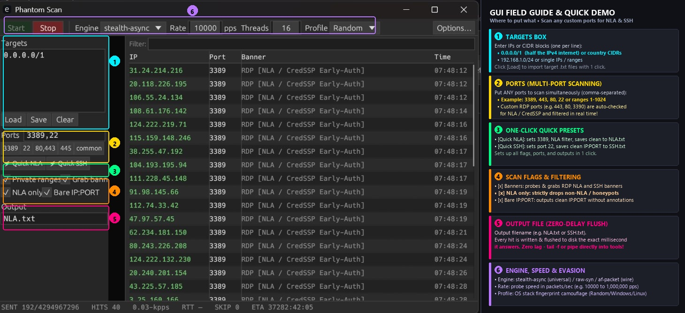

# 👻 PHANTOM-SCAN v0.3.4

> **Next-Generation Multi-Threaded Wire-Speed Network Scanner in Rust**  
> *Engineered to surpass masscan in speed, with built-in Anti-AbuseIPDB, OS Fingerprint Camouflage, Linux AF_PACKET Zero-Copy (PACKET_MMAP), and Zero-Drop Dual-Stack BPF.*

---

## 🖥️ Graphical User Interface (GUI) Preview & Field Guide



### Where to put what (GUI Walkthrough):

| Section / Control | What to Put / What it Does | Example |
| :--- | :--- | :--- |
| **Targets** | Enter target CIDRs, IP ranges, or single IPs (one per line). Click `Load` to load a `.txt` target file. | `0.0.0.0/1`<br>`192.168.1.0/24`<br>`103.0.0.0/10` |
| **Ports** | Enter as many ports as you want (comma-separated), ranges, or names. **Custom RDP on 443, 80, 3390?** Any port you choose is automatically probed for NLA / CredSSP! | `3389,443,80,22`<br>`80,443`<br>`1-1024` |
| **Port Presets** | Instant buttons for common services: `3389`, `22`, `80,443`, `445`, `common`. | Click `[3389]` |
| **⚡ Quick NLA** | **One-click RDP CredSSP scanner:** Probes for RDP, activates NLA-only filter, sets clean `IP:PORT` format, and streams hits directly into `NLA.txt`. | Click `[⚡ Quick NLA]` |
| **⚡ Quick SSH** | **One-click SSH scanner:** Targets SSH, sets clean `IP:PORT` format, and streams hits directly into `SSH.txt`. | Click `[⚡ Quick SSH]` |
| **Banners** | Connects to discovered open ports and grabs service headers (RDP version/NLA, SSH banner, HTTP title). | Checked (required for NLA) |
| **Private IP** | Check to allow scanning RFC 1918 private subnets (`10.0.0.0/8`, `172.16.0.0/12`, `192.168.0.0/16`). | Checked for LAN/VPC |
| **NLA only** | **Strict Filter:** Drops honeypots and non-NLA servers, saving *only* confirmed CredSSP/NLA endpoints. | Checked |
| **Bare IP:PORT** | Formats output strictly as clean `IP:PORT` (one per line) ready for piping into downstream tools. | Checked |
| **Output** | Destination file for discovered hits. Saved in real time the instant each hit arrives. | `NLA.txt` or `SSH.txt` |
| **Engine** | • `stealth-async`: Universal user-space scanner (no root/admin required).<br>• `raw-syn`: High-speed raw SYN packet injection (Requires Admin).<br>• `af-packet`: Linux zero-copy ring buffer (wire speed). | `stealth-async` (Default) |
| **Rate (pps)** | Probe transmission rate in Packets Per Second. | `10000` to `1000000` |
| **Threads** | Number of dedicated worker threads. | `16` (or CPU count) |
| **Profile** | TCP stack OS camouflage signature (`Random`, `Windows`, `Linux`, `macOS`). Jitters TTL and option signatures to evade IDS/honeypots. | `Random` |
| **Options...** | Access BGP Country Route Generator (download all CIDRs for entire countries like `KR`, `US`, `DE`), custom MACs, and exclude feeds. | Click to open modal |

> 💡 **Multi-Port & Custom RDP Ports**: You can scan as many ports as you want at once (e.g. `443,22,80,3389` or `1-1024`). If you run RDP on non-standard ports (such as `443`, `80`, or `3390`), Phantom Scan automatically probes each port with RDP negotiation, detects NLA/CredSSP capabilities, and streams confirmed NLA targets straight to `NLA.txt`, while streaming SSH targets to `SSH.txt`!

---

## ⚡ Feature Matrix vs Masscan

| Capability | Masscan | Phantom-Scan v0.3.0 |
| :--- | :--- | :--- |
| **TX Engine** | Single-threaded packet generator | **Multi-threaded independent raw sockets & Zero-Copy AF_PACKET (PACKET_MMAP rings)** |
| **Layer 2 Auto-Discovery** | Hardcoded/manual configuration | **Automatic interface `ifindex`, local MAC, and default gateway ARP resolution** |
| **Subnet Anti-Abuse** | Hits same `/24` repeatedly in bursts | **Exact 16,777,216 `/24` Cooldown Ring (0% collisions, 64MB RAM) + `/64` IPv6 tracking** |
| **Packet Camouflage** | Static `Window=1024`, no TCP options | **Windows 11, Linux, macOS, FreeBSD, Android Profiles + Advancing Synthetic Uptime TSval** |
| **IP ID Dynamics** | Static or sequential | **Stateful RFC 6864: Monotonic Windows IP ID, Linux ID = 0, pseudo-random others** |
| **Drop Prevention** | Standard raw socket (drops under load) | **16MB Kernel RX Ring + Dual-Stack cBPF In-Kernel Filter** |
| **Post-Scan Drain & Retries**| Static hardcoded delay (3-10 sec) | **Adaptive RTT Estimator (Jacobson/Karels RFC 6298) + Automatic Retransmission Pass** |
| **Service Intelligence**| Port open only | **Stateless SYN-Cookie + Bounded Async Banner Pool (RDP NLA/TLS/CredSSP, SMB2, SSH, HTTP, MySQL, Redis)**|
| **Dual-Stack** | IPv4 only | **Full IPv4 & IPv6 Dual-Stack (Blackrock + BLAKE3 Cookies + IPv6 Prefix Sampling)** |
| **Threat Exclusion** | Manual `--excludefile` | **Embedded Radix Trie + Automated 24h Threat Feed Cache (Spamhaus, FireHOL, Blocklist.de, GreyNoise)** |
| **Portability** | Requires C dependencies | **Pure Rust: Cross-compiles to Windows MSVC & Linux Musl** |

---

## 🛡️ Anti-AbuseIPDB Architecture

### 1. Exact 16,777,216 Subnet Cooldown (`--cooldown-ms`)
Automated abuse engines (Fail2ban, CrowdSec, Honeypot APIs) fire when $\ge 3$ probes hit the same `/24` or `/16` within seconds.
`phantom-scan` maintains a direct dense array covering every `/24` subnet on the planet ($2^{24} = 16,777,216$ cells):
* **Guaranteed 0% collisions:** Every `/24` prefix has its own atomic timestamp cell.
* Direct memory indexing: `(ip >> 8)` ($<1$ nanosecond memory lookup).
* Probes to the same organization are safely interleaved across other continents.
* Use `--compact-cooldown` for memory-constrained devices (4MB).

### 2. Authentic OS Fingerprint Synthesis (`--profile`)
Honeypots (Cowrie, Dionaea) and IDS (Suricata, Zeek) immediately flag masscan's `Window=1024` with no options. `phantom-scan` crafts authentic client packets:
* **`--profile windows`:** TTL 128, Window 64240, MSS 1460, NOP, WScale(8), NOP, NOP, SACK Permitted.
* **`--profile linux`:** TTL 64, IP ID 0 (RFC 6864), Window 65495, MSS 1460, SACK Permitted, Timestamps, NOP, WScale(7).
* **`--profile macos`:** TTL 64, Window 65535, MSS 1440, NOP, WScale(6), NOP, NOP, Timestamps, SACK, EOL.
* **`--profile freebsd` / `--profile android`:** Genuine BSD and mobile TCP signatures.
* **`--randomize-stack`:** Adds network hop jitter to TTL and permutes compatible TCP option sequences.
* **`--source-port-range 40000-65000`:** Ephemeral source port randomization with BLAKE3 cookie cryptographic binding.

### 3. Automated Threat Feeds & Honeypot Drop (`--update-feeds`)
Automatically checks cache age on startup ($>24\text{h}$) and refreshes in the background, or run manually:
```bash
phantom-scan --update-feeds
```
Downloads and indexes 30,000+ verified honeypot and threat prefixes directly into the dual-stack prefix trie:
* Spamhaus DROP & EDROP lists
* FireHOL Level 1 & AbuseIPDB sensor networks
* GreenSnow & GreyNoise observatory ranges
* Blocklist.de Attacker Netsets
* US Military & DoD ranges (`6.0.0.0/8`, `11.0.0.0/8`, `21.0.0.0/8`, etc.)

---

## ⚡ Zero-Copy AF_PACKET Kernel-Bypass Engine

On Linux, `phantom-scan` provides true line-rate zero-copy kernel bypass via `PACKET_MMAP`:
1. **L2 Auto-Discovery (`-I`, `--gateway-mac`, `--source-mac`):** Resolves interface name, `ifindex`, hardware MAC, and default gateway ARP MAC.
2. **Multi-Threaded `PACKET_TX_RING`:** Spawns independent TX sender threads, each mapping a private 4MB ring buffer bound to `ifindex`.
3. **Batch DMA Injection:** Formats wire Ethernet frames directly into mapped memory; kicks transmissions with a single `send()` syscall every 64 frames.
4. **Zero-Drop 16MB `PACKET_RX_RING`:** In-kernel dual-stack cBPF filter drops 99.99% of wire traffic in kernel interrupt space before copying to userspace.
5. **Retransmission Pass (`--retries 1`):** Tracks unanswered targets and triggers a paced re-probe pass at the observed Jacobson/Karels RTO.

---

## 🚀 CLI Examples

```bash
# 1. Update threat feeds (Spamhaus, GreyNoise, AbuseIPDB, Blocklist.de)
phantom-scan --update-feeds

# 2. Linux AF_PACKET Zero-Copy line-rate scan with PACKET_FANOUT multi-queue TX & banner grabbing
phantom-scan -t 192.168.1.0/24 -p 3389 -b -m af-packet -S 192.168.1.100 --tx-threads 16 --fanout-mode lb -r 250000

# 3. Multi-threaded wire-speed scan with Windows stack morphing & source port range
phantom-scan -f targets.txt -p 3389,445 -r 50000 --profile windows --source-port-range 40000-60000 -m raw-syn -S 192.168.1.100

# 4. Large-scale scan with exact /24 anti-abuse cooldown (3,000ms) and retry pass
phantom-scan -f targets.txt -p 3389 -r 100000 --cooldown-ms 3000 --retries 1 -o open_hosts.txt

# 5. IPv6 dual-stack scan with random host sampling per /64 prefix
phantom-scan -t 2606:4700::/64 -p 80,443 --v6-samples 512 -m stealth-async -o v6_web.txt

# 6. Universal high-throughput async engine (works on any cloud VPS without root)
phantom-scan -f subnets.txt -p rdp,ssh,web -b -r 25000 -o live_services.txt

# 7. Output in JSON Lines with timestamps & service banners
phantom-scan -f targets.txt -p 3389 -b --json -o results.jsonl

# 8. Quick RDP NLA Scan (checks NLA/CredSSP, saves confirmed hosts to NLA.txt right on hit)
phantom-scan -f targets.txt --quick-nla

# 9. Quick SSH Scan (saves clean IP:PORT directly to SSH.txt right on hit)
phantom-scan -f targets.txt --quick-ssh
```
